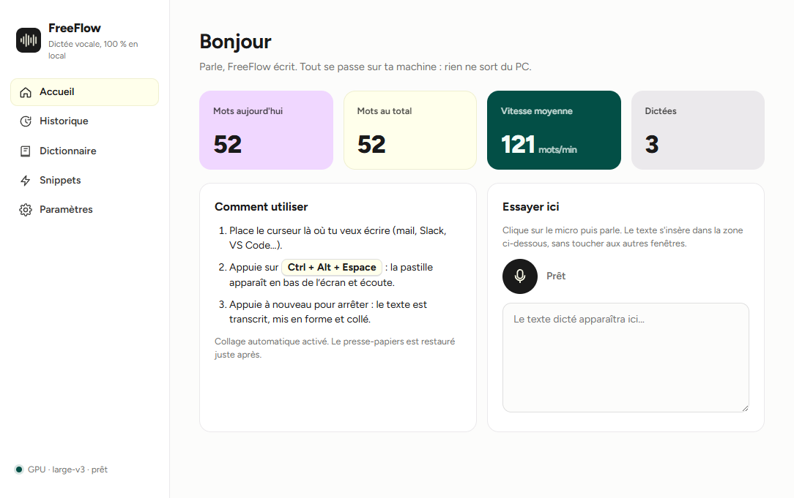
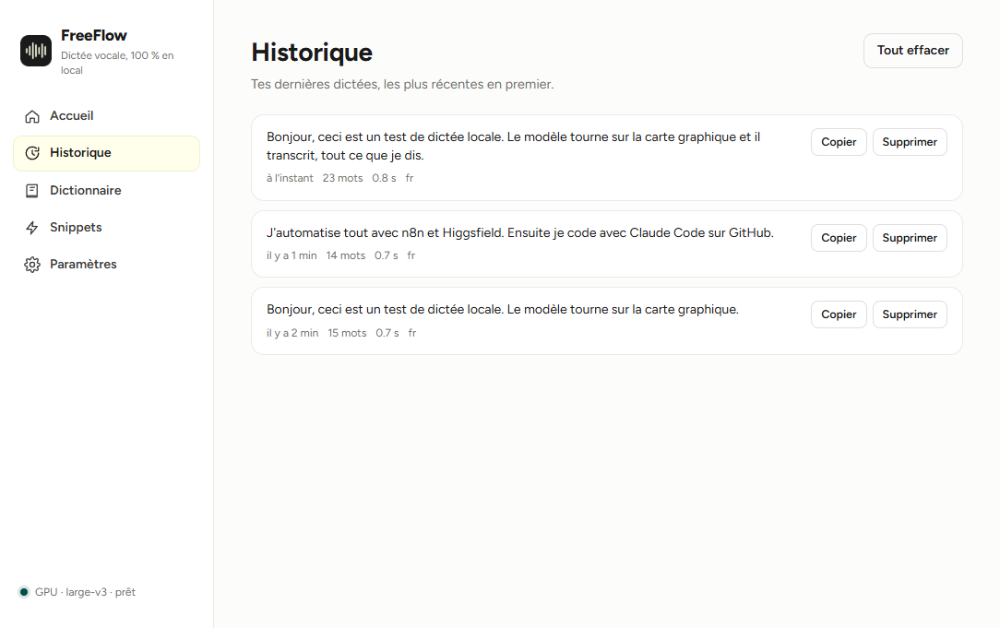
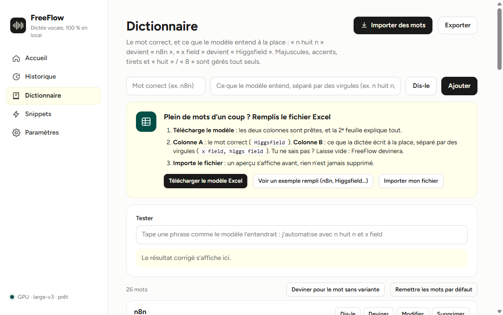
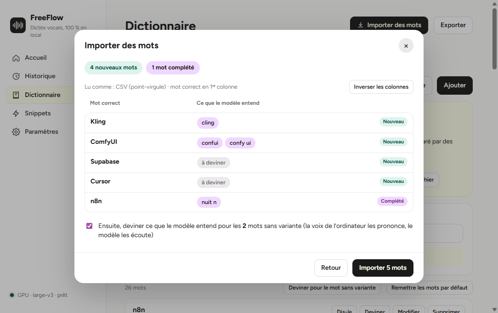

<p align="center"></p>

<h1 align="center">FreeFlow</h1>

<p align="center"><b>La dictée vocale 100 % locale pour Windows et Mac.</b><br>
Un raccourci, tu parles, le texte s'écrit là où se trouve ton curseur.<br>
Gratuit, open source, sans compte, sans abonnement, et rien ne quitte ton ordinateur.</p>

<p align="center">
  <a href="https://github.com/AlanECE/freeflow/releases/latest/download/FreeFlow-Setup.exe"></a>
  &nbsp;
  <a href="https://github.com/AlanECE/freeflow/releases/latest/download/FreeFlow-Mac.dmg"></a>
  <br><sub>Windows 10 / 11 · Mac à puce Apple (M1 et plus récents), macOS 12 ou plus · gratuit, sans compte</sub>
</p>

<p align="center"></p>

## Ce que ça fait

- **Dictée partout** : dans un mail, Notion, Slack, ChatGPT, VS Code… Appuie sur `Ctrl + Alt + Espace` (sur Mac : `⌥ Option + Espace`), parle, appuie à nouveau : le texte est collé là où tu écris.
- **Deux façons de dicter** : un appui pour démarrer puis un appui pour arrêter (mains libres), ou garder la touche enfoncée pendant que tu parles (push-to-talk). Le raccourci se change dans Paramètres (bouton *Enregistrer* puis *Confirmer*) ; les combinaisons de touches de modification seules marchent aussi (ex. `Ctrl + Win`).
- **Transcription locale** : le modèle Whisper `large-v3` tourne sur ta carte graphique NVIDIA (moins d'une seconde pour 10 secondes de voix sur une RTX récente). Sans carte NVIDIA, et sur Mac, FreeFlow tourne sur le processeur avec un modèle plus léger ; tu peux en choisir un plus précis dans Paramètres.
- **Vocabulaire** : apprends-lui tes mots. « n huit n » devient `n8n`, « x field » devient `Higgsfield`. Pour chaque mot, tu indiques ce que le modèle entend à la place ; un champ de test montre la correction en direct.
- **Importer tout un dictionnaire d'un coup** : télécharge le **modèle Excel** depuis l'application (deux colonnes prêtes, mode d'emploi dans la 2ᵉ feuille), remplis-le, importe-le. Marche aussi avec un CSV, un fichier texte, une liste collée (celle que ChatGPT ou Claude t'a préparée) ou ton dictionnaire **Wispr Flow** repris en un clic. Un aperçu montre ce qui sera ajouté avant d'importer. Voir [Importer un dictionnaire](#importer-un-dictionnaire).
- **FreeFlow trouve tout seul ce que le modèle entend** : *Dis-le* (tu prononces le mot, FreeFlow note comment le modèle l'a écrit) ou *Deviner* (la voix de l'ordinateur prononce le mot, le modèle l'écoute). Tu n'as plus qu'à cocher.
- **Snippets** : un mot déclencheur remplacé par un texte (ton adresse, une signature, un lien…).
- **Mise en forme** : les « euh » et « hum » sont retirés, les majuscules, les espaces avant `? ! ; :` et la casse de tes mots sont corrigées.
- **Historique** : toutes tes dictées, avec le nombre de mots et le temps de transcription, à recopier en un clic.
- **Vie privée** : une fois le modèle téléchargé, FreeFlow n'a plus besoin d'Internet. Ta voix, tes textes et ton historique restent sur ton disque.

<p align="center">
  
  
</p>

<p align="center">
  
  
</p>

## Installer sur Windows

1. Télécharge **[FreeFlow-Setup.exe](https://github.com/AlanECE/freeflow/releases/latest/download/FreeFlow-Setup.exe)** (page des versions : [Releases](https://github.com/AlanECE/freeflow/releases)).
2. Lance-le. L'installateur n'est pas signé numériquement, Windows affiche donc « Windows a protégé votre ordinateur » : clique sur **Informations complémentaires**, puis **Exécuter quand même**.
3. Choisis le dossier (par défaut `%LOCALAPPDATA%\Programs\FreeFlow`, aucun droit administrateur demandé). Un raccourci est créé sur le bureau et dans le menu Démarrer.
4. Au premier lancement, FreeFlow télécharge le modèle de reconnaissance vocale depuis Hugging Face, **une seule fois** : environ **3 Go** avec une carte NVIDIA (`large-v3`), **0,5 Go** sans (`small`). La progression s'affiche dans la fenêtre et dans l'icône près de l'horloge. Quand c'est écrit « prêt », appuie sur `Ctrl + Alt + Espace` et parle.

FreeFlow reste dans la zone de notification (près de l'horloge) : clic droit sur l'icône pour ouvrir la fenêtre, lancer une dictée ou quitter.

## Installer sur Mac

Pour les Mac à puce Apple (M1, M2, M3, M4…) avec macOS 12 ou plus récent.

1. Télécharge **[FreeFlow-Mac.dmg](https://github.com/AlanECE/freeflow/releases/latest/download/FreeFlow-Mac.dmg)**, ouvre-le et glisse **FreeFlow** dans le dossier **Applications**.
2. Ouvre FreeFlow. Comme l'application n'est pas certifiée par Apple (le certificat coûte 99 $ par an), macOS la bloque la première fois : va dans **Réglages Système → Confidentialité et sécurité**, descends jusqu'au message sur FreeFlow et clique sur **Ouvrir quand même**, puis confirme. Ce n'est à faire qu'une fois.
3. Donne les deux autorisations que FreeFlow demande sur sa page d'accueil :
   - **Micro**, pour entendre ta voix ;
   - **Accessibilité**, pour coller le texte là où tu écris (et pour le mode « maintenir pour parler ») : dans **Réglages Système → Confidentialité et sécurité → Accessibilité**, active **FreeFlow**.
4. Au premier lancement, FreeFlow télécharge le modèle de reconnaissance vocale (0,5 Go), une seule fois. Quand l'icône de la barre des menus est prête, appuie sur `⌥ Option + Espace` et parle.

Sur Mac, le modèle tourne sur le processeur. Le modèle *Rapide* (par défaut) est le plus réactif ; sur un Mac M2 ou plus récent, essaie *Équilibré* dans Paramètres → Moteur local pour une transcription plus juste.

### Configuration conseillée (Windows)

| | Minimum | Conseillé |
|---|---|---|
| Système | Windows 10 ou 11, 64 bits | Windows 11 |
| Carte graphique | aucune (mode processeur, modèle `small`) | NVIDIA GeForce GTX 16xx / RTX avec 6 Go de mémoire vidéo ou plus, pilote récent |
| Disque | 3 Go | 6 Go (application + modèle `large-v3`) |
| Mémoire | 8 Go | 16 Go |

Avec moins de mémoire vidéo, FreeFlow essaie d'abord une version allégée du modèle (`int8_float16`), puis le processeur.

## Utiliser

| Action | Comment |
|---|---|
| Dicter | `Ctrl + Alt + Espace`, parle, `Ctrl + Alt + Espace` |
| Push-to-talk | Paramètres → *Maintenir pour parler* : garde la touche enfoncée, relâche pour transcrire. Un appui bref passe en mains libres |
| Changer le raccourci | Paramètres → Raccourci → *Enregistrer*, tape ta combinaison, *Confirmer* |
| Langue | Paramètres → Langue : automatique, français ou anglais (forcer la langue aide sur les phrases très courtes) |
| Ajouter un mot | Dictionnaire → le mot correct + ce que le modèle entend à la place, puis *Tester* |
| Trouver ce que le modèle entend | *Dis-le* : prononce le mot deux ou trois fois, puis *Arrêter*. *Deviner* : la voix de l'ordinateur le prononce pour toi. Coche les propositions, puis *Ajouter* |
| Importer une liste de mots | Dictionnaire → *Importer des mots* (voir plus bas) |
| Changer de modèle | Paramètres → Moteur local → Modèle (*Rapide*, *Équilibré*, *Précis*, *Maximum*) |
| Sans collage automatique | Paramètres → décoche *Coller automatiquement* : le texte est seulement copié, colle-le avec `Ctrl + V` (`⌘ V` sur Mac) |

Le presse-papiers est remis comme avant juste après le collage. Sous Windows, les fenêtres lancées en administrateur refusent le collage simulé : le texte reste alors dans le presse-papiers.

## Importer un dictionnaire

1. Dans FreeFlow → Dictionnaire, sous « Mot correct », clique sur **Télécharger le modèle Excel** (ou **Voir un exemple rempli** avec n8n, Higgsfield…). Les mêmes fichiers sont ici : [modèle vide](docs/dictionnaire-modele.xlsx) · [exemple rempli](docs/dictionnaire-exemple.xlsx).
2. Remplis la feuille **Mes mots** ; la feuille **Mode d'emploi** explique tout.
3. **Importer mon fichier** (ou glisse-le dans la fenêtre). FreeFlow montre un aperçu (nouveaux mots, mots complétés, lignes ignorées) avant d'importer. Rien n'est jamais supprimé : un mot déjà présent gagne seulement les variantes qui lui manquaient.

**Le format** : une ligne par mot. Colonne A, le mot correct ; colonne B, ce que la dictée écrit à la place, séparé par des virgules :

| Mot correct | Ce que le modèle entend (séparé par des virgules) |
|---|---|
| n8n | n huit n, aine huit aine, n 8 n |
| Higgsfield | x field, higgs field, hicks field |
| Kling | |

- Un mot seul (comme `Kling` ci-dessus) suffit : laisse cochée la case « deviner ce que le modèle entend » à l'import et FreeFlow remplit la colonne pour toi.
- Fichiers acceptés : Excel `.xlsx`, CSV (Google Sheets, Numbers, Excel), texte `.txt`, JSON. En texte, tu peux aussi écrire `n8n = n huit n, aine huit aine` ou `x field -> Higgsfield`. Les variantes peuvent aussi être séparées par `;` ou `|`, ou mises une par case (colonnes C, D…).
- Un fichier de Wispr Flow (`phrase,remplacement`, le mot correct en 2ᵉ colonne) est reconnu ; le bouton **Inverser les colonnes** corrige le sens si besoin.
- **Wispr Flow installé sur ton ordinateur ?** Le bouton *Reprendre mon dictionnaire Wispr Flow* récupère tes mots et tes snippets, sans rien modifier chez Wispr.
- **Avec ChatGPT ou Claude** : *Copier le prompt*, colle-le dans le chat avec tes mots (ou ton métier), puis colle la réponse dans FreeFlow.

*Exporter* enregistre ton dictionnaire dans le même fichier Excel (ou en CSV), pour le partager ou le reprendre sur un autre ordinateur.

<p align="center"></p>

Les variantes qui sont des mots de tous les jours (« clean » pour *Kling*) sont proposées décochées : ajoutées, elles seraient remplacées dans toutes tes dictées.

## Désinstaller

**Windows** : Paramètres Windows → Applications → FreeFlow → Désinstaller. Le modèle téléchargé (`%LOCALAPPDATA%\FreeFlow\models`) est supprimé avec l'application. Tes réglages, ton dictionnaire et ton historique restent dans `%APPDATA%\FreeFlow` : supprime ce dossier si tu veux tout effacer.

**Mac** : quitte FreeFlow (icône de la barre des menus → Quitter) et mets-le à la corbeille depuis Applications. Le modèle, tes réglages, ton dictionnaire et ton historique sont dans `~/Library/Application Support/FreeFlow` : supprime ce dossier si tu veux tout effacer.

## Questions fréquentes

**La pastille dit « Modèle en cours de chargement ».** Le premier lancement télécharge le modèle, puis chaque démarrage le recharge en mémoire (5 à 20 secondes). Attends que l'icône affiche « prêt ».

**Le téléchargement du modèle échoue.** Vérifie ta connexion puis relance FreeFlow : le téléchargement reprend là où il s'était arrêté. Le journal est dans `%APPDATA%\FreeFlow\logs\freeflow.log`.

**Mon antivirus bloque l'installateur.** Il n'est pas signé (un certificat coûte plusieurs centaines d'euros par an). Le code source est entièrement dans ce dépôt et tu peux construire l'installateur toi-même (voir plus bas).

**Est-ce que ça marche sur Mac ?** Oui depuis la version 1.1, sur les Mac à puce Apple (voir [Installer sur Mac](#installer-sur-mac)). Les anciens Mac Intel et Linux ne sont pas pris en charge.

**Sur Mac, « FreeFlow est endommagé » ou rien ne se passe à l'ouverture.** Ouvre le Terminal et tape `xattr -dr com.apple.quarantine /Applications/FreeFlow.app`, puis relance FreeFlow.

**Sur Mac, le texte n'est pas collé (« Autorise FreeFlow dans Accessibilité »).** Réglages Système → Confidentialité et sécurité → Accessibilité : active FreeFlow. Après une mise à jour, macOS peut demander de le refaire : retire FreeFlow de la liste avec `−`, puis rajoute-le.

## Construire depuis les sources

Prérequis : Node.js 22, Python 3.11, et pour la version GPU les paquets `nvidia-cublas-cu12` et `nvidia-cudnn-cu12`.

```powershell
git clone https://github.com/AlanECE/freeflow.git
cd freeflow
npm install
pip install faster-whisper pyinstaller nvidia-cublas-cu12 "nvidia-cudnn-cu12<10"
npm run build:native    # native/PasteHelper.exe (collage simulé, csc.exe du .NET Framework 4)
npm run build:stt       # moteur de transcription : stt/dist/freeflow-stt (PyInstaller + DLL CUDA)
npm run release         # application dans release/FreeFlow-win32-x64, installateur dans release/installer
```

Sur Mac (puce Apple, Node.js 22, Python 3.11) :

```bash
npm install
pip install faster-whisper pyinstaller
python3 stt/build_stt.py   # moteur processeur : stt/dist/freeflow-stt
npm run release:mac        # application signée ad hoc + release/installer/FreeFlow-Mac.dmg
```

La version Mac est aussi construite et testée sur un vrai Mac par GitHub Actions ([.github/workflows/mac.yml](.github/workflows/mac.yml)) : à chaque release publiée, `FreeFlow-Mac.dmg` y est joint automatiquement.

Pour développer : `npm start` (le moteur est lancé avec `python stt/stt_server.py` s'il n'a pas été compilé) et `npm test` pour les tests du dictionnaire. Si la variable `ELECTRON_RUN_AS_NODE` est définie dans ton terminal (c'est le cas dans certains éditeurs), retire-la avant, sinon Electron démarre comme un simple Node.

Le fonctionnement interne est décrit dans [docs/ARCHITECTURE.md](docs/ARCHITECTURE.md).

## Crédits et licences

FreeFlow est sous licence [MIT](LICENSE). Il repose sur [faster-whisper](https://github.com/SYSTRAN/faster-whisper) et [CTranslate2](https://github.com/OpenNMT/CTranslate2) (MIT), le modèle [Whisper](https://github.com/openai/whisper) d'OpenAI (MIT, version convertie par [Systran](https://huggingface.co/Systran)), [Electron](https://www.electronjs.org/) (MIT), [uiohook-napi](https://github.com/SnosMe/uiohook-napi) (MIT) et la police [Figtree](https://fonts.google.com/specimen/Figtree) (SIL OFL 1.1). L'installateur embarque les bibliothèques NVIDIA cuBLAS et cuDNN, redistribuées selon les licences de NVIDIA. Détails : [THIRD_PARTY_NOTICES.md](THIRD_PARTY_NOTICES.md).

FreeFlow est un projet indépendant inspiré des applications de dictée comme Wispr Flow. Il n'est ni affilié à Wispr ni approuvé par Wispr, et ne contient aucun code ni aucun fichier de Wispr Flow.
